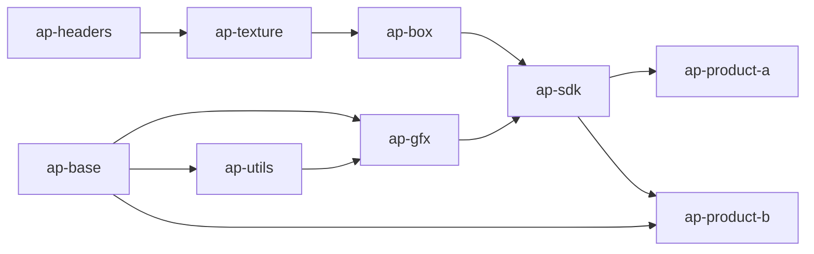

# Conan 2 migration sandbox

Учебный многопакетный проект для воспроизведения проблем миграции CI на Conan 2:
version ranges, мажорные версии, конфликты пинов и воспроизводимость старых
продуктов через lockfile + package list.

> Это **не** production-проект. Все библиотеки намеренно маленькие, но
> `test_package` реально вызывает их функции и проверяет результат через
> `assert`.

Документ по миграции: [`../../conan1-conan2-migration-runbook.md`](../../conan1-conan2-migration-runbook.md) — единственная
инструкция перехода Conan 1.x → Conan 2.x. Артефакты хранятся в JFrog
Artifactory; Gitea используется только для исходников, Jenkins — как
CI/CD runner.

## Архитектура



Точные требования:

| Пакет | Требования |
|---|---|
| `ap-utils` | `ap-base/[>=1.0 <2]` |
| `ap-gfx` | `ap-base/[>=1.0 <2]`, `ap-utils/[>=1.0 <2]` |
| `ap-texture` | `ap-headers/[>=1.4 <2]` |
| `ap-box` | `ap-headers/1.3.290` (пин), `ap-texture/[>=1.0 <2]` |
| `ap-sdk` | `ap-gfx/[>=1.0 <2]`, `ap-box/[>=1.0 <2]` |
| `ap-product-a` | `ap-sdk/[>=1.0 <2]` |
| `ap-product-b` | `ap-sdk/[>=1.0 <2]`, `ap-base/[>=1.0 <2]` |

### Разрешение конфликта `ap-headers`

`ap-texture` требует `ap-headers/[>=1.4 <2]`, а `ap-box` пинит
`1.3.290`. Буквально такой граф неразрешим. Чтобы базовый сценарий 01 был
зелёным, в `ap-box` использован осознанный `force=True`:

```python
self.requires("ap-headers/1.3.290", force=True)
```

Это эмуляция внешнего SDK, который жёстко фиксирует версию headers. `force`
заменяет диапазон, пришедший из `ap-texture`, и делает граф
разрешимым. `force` также оставляет требование прямым: `CMakeDeps` получает
`headers=True` и генерирует include-пути. С `override=True` в Conan 2.33
ребро получает `headers=False`, include-пути пустые, и сборка `ap-box` падает на
`ap-headers/ap-headers.h: No such file or directory`. Без любого из
этих механизмов `conan create ap-box` падает на конфликте версий — это и есть
демонстрация проблемы «один пин против диапазона».

## Git-репозитории Gitea (только исходники)

В demo исходники лежат локально в `libs/`, `products/` и `demo/recipe-demo`.
При раскладке по Gitea каждый библиотечный пакет выносится в отдельный
репозиторий организации `packages`, продукт — в репозиторий организации
`products`.

| Репозиторий | Назначение |
|---|---|
| `packages/ap-base` | рецепт, исходники и `test_package` для `ap-base` |
| `packages/ap-headers` | рецепт и заголовки Graphics |
| `packages/ap-utils` | рецепт `ap-utils` |
| `packages/ap-gfx` | рецепт `ap-gfx` |
| `packages/ap-texture` | рецепт `ap-texture` |
| `packages/ap-box` | рецепт `ap-box` с пином `ap-headers/1.3.290` |
| `packages/ap-sdk` | рецепт `ap-sdk` |
| `packages/recipe-demo` | отдельный recipe-репозиторий для проверки миграции: `recipe-demo/1.0.0`; локальные исходники — в `demo/recipe-demo` |
| `products/ap-product-a` | репозиторий-рецепт продукта: `conanfile.py`, `src/`, `test_package/` |

Ссылки: `http://localhost:3000/packages/<name>` и
`http://localhost:3000/products/ap-product-a`.

`recipe-demo` — дополнительный fixture: отдельный Git-репозиторий
с header-only рецептом. Собранный пакет `recipe-demo/1.0.0` публикуется
только в JFrog Artifactory `packages`.

Все Conan-бинарники и рецепты хранятся в JFrog Artifactory CE for C/C++:
remote `packages`, `products`, `develop` указывают на
`http://localhost:8082/artifactory/api/conan/<repo>`. Gitea не используется
как Conan Package Registry.

### Текущее состояние Artifactory

Исторический снимок исходного дерева репозиториев:
[`initial-conditions.md`](initial-conditions.md).

Source-структура Conan 1.x сохранена для истории миграции; demo пишет только
в target-репозитории `packages`, `products` и `develop`. Ниже — целевая
раскладка source-репозиториев:

| Репозиторий | Тип | Содержимое |
|---|---|---|
| `conan` | VIRTUAL | `conan-local`, `ap-source`, `conan-thirdparty`, `ap-thirdparty`, `conan-remote` |
| `conan-local` | LOCAL | `ap-product-a`, `ap-product-b`, `recipe-demo` |
| `ap-source` | LOCAL | `ap-base`, `ap-utils`, `ap-gfx`, `ap-texture`, `ap-box`, `ap-sdk` |
| `conan-thirdparty` | LOCAL | `ap-headers/1.3.290`, `ap-headers/1.4.1` |
| `ap-thirdparty` | LOCAL | пуст (резерв) |
| `generic-local` | LOCAL Generic | пуст |
| `conan-remote` | REMOTE | `https://center.conan.io` |

Target Conan 2.x: `packages` (библиотеки `ap-*`), `products`
(`ap-product-a`, `ap-product-b`), `develop` (продвинутые продукты),
`conancenter-fork` (бинарники из приватного форка Conan Center) и virtual
`conan2`. Пакеты пересобраны Conan 2.33.0; порядок миграции —
[`../../conan1-conan2-migration-runbook.md`](../../conan1-conan2-migration-runbook.md).

Локальная сборка продукта из этой копии demo:

```bash
cd demo/conan-migration-sandbox
AP_PRODUCT_A_VERSION=1.0.0 conan create products/ap-product-a \
  -pr:h=profiles/linux-gcc-release \
  -pr:b=profiles/linux-gcc-release \
  -s build_type=Release
```

`ap-product-a` требует `ap-sdk/[>=1.0 <2]` и собирает исполняемый файл,
который вызывает `ap_sdk_render()`. Jenkins job `ap-product-a` делает
checkout из Gitea, запускает `test_package` и публикует пакет в JFrog
`develop`.

## Версии

Версия каждого пакета задаётся через `set_version()` и переменную окружения,
поэтому из одной папки можно собрать несколько версий:

| Пакет | Переменная | Версии «из коробки» |
|---|---|---|
| `ap-base` | `AP_BASE_VERSION` | `1.0.0`, `1.1.0`, `2.0.0` |
| `ap-headers` | `AP_HEADERS_VERSION` | `1.3.290`, `1.4.1` |
| `ap-texture` | `AP_TEXTURE_VERSION` | `1.0.0`, `1.1.0` |
| `ap-box` | `AP_BOX_VERSION` | `1.0.0` |
| `ap-utils` | `AP_UTILS_VERSION` | `1.0.0` |
| `ap-gfx` | `AP_GFX_VERSION` | `1.0.0` |
| `ap-sdk` | `AP_SDK_VERSION` | `1.0.0` |
| `ap-product-a` | `AP_PRODUCT_A_VERSION` | `1.0.0` |
| `ap-product-b` | `AP_PRODUCT_B_VERSION` | `1.0.0` |

`packages-pipeline.sh <path> <version>` экспортирует нужную переменную
окружения перед вызовом Conan. Это важно: `set_version()` сам присваивает
версию, поэтому CLI-флаг `conan create --version=...` может быть перезаписан
значением из `set_version()`. Скрипты поэтому не полагаются на `--version`.

## Требования

- Conan **>= 2.32** (проверено на 2.33.0)
- GCC **>= 13**
- CMake **>= 3.25**
- Bash (WSL/Linux)
- `python3` для разбора JSON в скриптах
- Рекомендуемая установка Conan: `uv tool install conan`

Скрипты проверяют наличие `conan` в `PATH` и печатают подсказку про
`uv tool install conan`.

## Профили

- `profiles/linux-gcc-release` — GCC 13, `build_type=Release`, `compiler.cppstd=17`
- `profiles/linux-gcc-debug` — GCC 13, `build_type=Debug`, `compiler.cppstd=17`

`compiler.cppstd` задан именно как `17`, не `gnu17`.

## Быстрый старт

```bash
cd demo/conan-migration-sandbox

export CONAN_USERNAME=admin
export CONAN_PASSWORD='<artifactory-пароль>'
export ARTIFACTORY_URL=http://localhost:8082
export PACKAGES_REMOTE=packages
export PRODUCTS_REMOTE=products
export DEVELOP_REMOTE=develop

bash scripts/bootstrap-remotes.sh
```

Сборка библиотек в порядке зависимостей:

```bash
bash scripts/packages-pipeline.sh libs/ap-base 1.0.0
bash scripts/packages-pipeline.sh libs/ap-headers 1.3.290
bash scripts/packages-pipeline.sh libs/ap-headers 1.4.1
bash scripts/packages-pipeline.sh libs/ap-utils 1.0.0
bash scripts/packages-pipeline.sh libs/ap-gfx 1.0.0
bash scripts/packages-pipeline.sh libs/ap-texture 1.0.0
bash scripts/packages-pipeline.sh libs/ap-box 1.0.0
bash scripts/packages-pipeline.sh libs/ap-sdk 1.0.0
```

Продукты:

```bash
bash scripts/products-pipeline.sh products/ap-product-a
bash scripts/products-pipeline.sh products/ap-product-b
```

Полный пошаговый сценарий — `../../scenarios/01-basic-build.md`.

### Staged CI: релиз без «рецепта без бинарников»

Для CI используйте отдельные `ci-*` скрипты. Они не заменяют пошаговые
`packages-pipeline.sh`/`products-pipeline.sh`, а реализуют релизный порядок:

```bash
# 1. библиотека: Release + Debug локально, затем полная публикация
bash scripts/ci-package-release.sh libs/ap-headers 1.4.2

# 2. продукты: один граф, один build-order, promote всего набора
export CI_RESOLVE_REMOTE=products
bash scripts/ci-products-release.sh --dry-run
bash scripts/ci-products-release.sh
bash scripts/ci-verify-release.sh
```

| Скрипт | Что гарантирует |
|---|---|
| `ci-package-release.sh <path> <version>` | рецепт не попадает в `packages` до сборки Release и Debug; package ID сверяются; опционально promote в `products` |
| `ci-products-release.sh` | единый lockfile для `ap-product-a` и `ap-product-b`; сборка всего build-order; upload/promote только после успеха; манифест последним |
| `ci-verify-release.sh` | все refs из `release-manifest.json` есть в `develop` и имеют бинарники |

Единый граф задаётся в `ci/all-products/conanfile.py`. Он не публикуется;
это только корень для `conan lock create` и `conan graph build-order`.

Артефакты релиза:

```text
lockfiles/ci/all-products.lock
lockfiles/ci/release-manifest.json
lockfiles/ap-product-a/ap-product-a.lock
lockfiles/ap-product-b/ap-product-b.lock
```

Подробные сценарии — `../../scenarios/05-staged-package-release.md` …
`../../scenarios/08-conan1-to-conan2-cutover.md`.

### Важно про запуск в WSL/DrvFs

Запускайте скрипты как `bash scripts/...`, а не `./scripts/...`: на DrvFs
исполняемый бит и shebang могут не сработать (`os error 193`).

## Lockfile и package list

- `lockfiles/<product>/<product>.lock` — **коммитим**. Он фиксирует recipe
  revisions и версии графа.
- `lockfiles/<product>/<product>-packagelist.json` — **коммитим**. Это результат
  `conan list "<product>/*:*#*" -r=develop --format=json` после успешной
  сборки. Шаблон `:*#*` обязателен: без него Conan не печатает package
  revisions, и бинарник нельзя воспроизвести точно.

Lockfile **не содержит** `package_id` и `package_rev` бинарных пакетов. Для
полной воспроизводимости нужно знать не только «какой версии recipe», но и
«какой именно бинарник» был собран. Поэтому package list обязателен и хранится
рядом с lockfile.

После успешной сборки `products-pipeline.sh` дополнительно сохраняет
неизменяемые копии с версией в имени:

```
lockfiles/ap-product-a/ap-product-a-1.0.0.lock
lockfiles/ap-product-a/ap-product-a-1.0.0-packagelist.json
```

Используйте их для воспроизведения старой версии, когда в `develop` уже
появились новые библиотеки (см. `../../scenarios/04-reproducible-old-version.md`).

`ci-products-release.sh` дополнительно пишет `lockfiles/ci/all-products.lock`
(единый граф обоих продуктов) и `lockfiles/ci/release-manifest.json` —
указатель полного релиза. Манифест создаётся последним; его наличие означает,
что все refs были собраны и продвинуты.

Lockfile'ы в репозитории — результат прогонов сценариев 01 и 05–06. Повторный
запуск `packages-pipeline.sh`/`products-pipeline.sh`/`ci-*` перезаписывает рабочие
`*.lock`, а для продуктов дополнительно сохраняет неизменяемые копии с
версией в имени.

## Скрипты

| Скрипт | Назначение |
|---|---|
| `bootstrap-remotes.sh` | Добавляет/обновляет 3 remote, логинится, ставит их перед `conancenter` |
| `packages-pipeline.sh <path> <version>` | Release + Debug, lockfile на конфигурацию, merge, upload в `packages` |
| `products-pipeline.sh <path>` | Единый lockfile, build-order по конфигурациям, merge, сборка, upload в `products`, promote в `develop`, package list |
| `ci-package-release.sh <path> <version> [--no-promote]` | Staged-релиз библиотеки: обе конфигурации до upload, сверка package ID, promote в `products` |
| `ci-products-release.sh [--dry-run] [--no-promote]` | Единый граф продуктов, merged build-order, сборка всего набора, promote в `develop` (с `--no-promote` — проверка в `products`), манифест последним |
| `ci-verify-release.sh [manifest]` | Проверка всех refs и бинарников релиза в `develop` или `CI_VERIFY_REMOTE` |
| `ci-lib.sh` | Общие функции: версии, пути, JSON-разбор, сверка package ID |
| `promote.sh <ref-pattern> <src> <dst>` | `list → download → upload` вместо `conan art:promote` |
| `scenario-major-bump.sh <pkg> <old> <new>` | Сборка новой версии, promote в products, попытка сборки продуктов |

Remote-имена настраиваются через `PACKAGES_REMOTE`, `PRODUCTS_REMOTE`,
`DEVELOP_REMOTE`; URL Artifactory — через `ARTIFACTORY_URL` (по умолчанию
`http://artifactory:8082`).

## Сценарии

Сценарии лежат в корне репозитория, в каталоге `../../scenarios/`.

| Сценарий | Тема |
|---|---|
| `01-basic-build.md` | базовая сборка и promote |
| `02-breaking-change.md` | новая версия ломает зависимых |
| `03-major-bump.md` | осознанный переход на major |
| `04-reproducible-old-version.md` | старый продукт из lockfile + package list |
| `05-staged-package-release.md` | публикация только полного пакета |
| `06-unified-product-release.md` | единый граф продуктов и promote набора |
| `07-major-prerelease.md` | политика major и pre-release |
| `08-conan1-to-conan2-cutover.md` | cutover CI с Conan 1 на Conan 2 |
| `09-conan-center-fork.md` | форк Conan Center как источник рецептов и бинарников |

## Известные ограничения

1. **`conan art:promote` недоступна** в Artifactory CE. Поэтому
   `promote.sh` делает `conan list` → `conan download` → `conan upload`.
   Операция идемпотентна, но не атомарна: при обрыве между download и upload
   возможен частичный перенос. `ci-products-release.sh` пишет
   `release-manifest.json` последним и проверяет набор через
   `ci-verify-release.sh`, но это указатель релиза, а не транзакция.
2. **Lockfile не содержит `package_id`/`package_rev`.** Без package list нельзя
   гарантировать, что соберётся/скачается именно тот бинарник. Package list
   коммитится рядом с lockfile и снимается с `:*#*`.
3. **Artifactory CE for C/C++ — одна нода.** PostgreSQL уже используется, но
   для production нужны внешний backup/retention и HA-редакция Artifactory.
4. `ap-box` использует `force=True` для `ap-headers/1.3.290`; это
   осознанное решение против неразрешимого конфликта с
   `ap-texture`. `override=True` в Conan 2.33 даёт `headers=False`
   и пустые include-пути в `CMakeDeps`. См. раздел выше.
5. Пайплайны собирают пакеты **из локальных исходников** по build-order, а не
   скачивают recipe из remote. Для реального CI это надо заменить на
   `conan install`/`conan create` из checkout-а соответствующего репозитория.
6. `products-pipeline.sh` заливает в `products` только локально собранные
   пакеты графа. Потребителю из `develop` могут понадобиться зависимости из
   `products`/`packages`; remote-порядок должен это учитывать.
7. Публичный ConanCenter содержит одноимённый `ap-base`, поэтому при порядке
   remote по умолчанию он может затенять `ap-base/1.0.0` из sandbox.
   `scripts/bootstrap-remotes.sh` ставит `packages`, `products`, `develop`
   перед `conancenter`; ручная настройка должна сохранять этот порядок.
8. `conan graph build-order-merge --reduce` на заполненном кэше может вернуть
   пустой `order`. `ci-products-release.sh` поэтому мержит без `--reduce` и
   дедуплицирует refs сам.
9. Pre-release по умолчанию не попадает в version range. Не добавляйте
   `include_prerelease` в стабильные диапазоны продуктов; используйте
   отдельный тестовый граф и явную версию.

## Как перенести в реальный CI

- Использовать `ci-package-release.sh` для библиотек и
  `ci-products-release.sh` для продуктов; старые `packages-pipeline.sh` /
  `products-pipeline.sh` оставить только для пошаговых сценариев.
- Заменить `promote.sh` на `conan art:promote` при переходе на Artifactory Pro.
- Вынести lockfile, package list и `release-manifest.json` в артефакты CI
  (lockfile — вход для reproducibility, package list — свидетельство
  содержимого, manifest — указатель релиза).
- Разнести сборку библиотек и единый релиз продуктов по разным Jenkins
  job/агентам; передавать lockfile/package list как artifacts.
- Собирать каждую конфигурацию на отдельном агенте и мержить build-order
  (`conan graph build-order-merge` без `--reduce`) перед запуском сборки.
- Для production использовать PostgreSQL для Gitea и Artifactory, включить
  backup/retention policy.
- Не публиковать `latest`/перезаписывать immutable версии; для breaking change
  выпускать новый major и расширять диапазоны только осознанным PR.

## Ручная проверка

1. `bash -n` для всех скриптов.
2. `python3 -m py_compile` для всех `conanfile.py`.
3. `bash scripts/bootstrap-remotes.sh` — три remote и успешный login.
4. Собрать библиотеки командами из быстрого старта; проверить
   `conan list 'ap-base/*:*#*' -r=packages`.
5. `bash scripts/products-pipeline.sh products/ap-product-a`; проверить
   `conan list 'ap-product-a/*:*#*' -r=develop` и наличие
   `lockfiles/ap-product-a/ap-product-a-packagelist.json`.
6. Повторить для `ap-product-b`.
7. Staged-релиз: `ci-package-release.sh libs/ap-headers 1.4.2`, затем
   `ci-products-release.sh --dry-run` и полный `ci-products-release.sh`;
   проверить `release-manifest.json` и `ci-verify-release.sh`.
8. Отрицательная проверка: сломать исходник в копии, убедиться, что
   `release-manifest.json` не создан, а `develop` не изменился.
9. Пройти `../../scenarios/01-basic-build.md` … `../../scenarios/09-conan-center-fork.md`.
10. Для миграции хранилища выполнить
    [`../../conan1-conan2-migration-runbook.md`](../../conan1-conan2-migration-runbook.md):
    freeze, service account, TLS, backup, cutover и rollback.

## Структура

```
conan-migration-sandbox/
├── README.md
├── Jenkinsfile
├── libs/
│   ├── ap-base/
│   ├── ap-utils/
│   ├── ap-gfx/
│   ├── ap-headers/
│   ├── ap-texture/
│   ├── ap-box/
│   └── ap-sdk/
├── products/
│   ├── ap-product-a/
│   └── ap-product-b/
├── profiles/
│   ├── linux-gcc-release
│   └── linux-gcc-debug
├── ci/
│   └── all-products/
│       └── conanfile.py
├── scripts/
│   ├── bootstrap-remotes.sh
│   ├── packages-pipeline.sh
│   ├── products-pipeline.sh
│   ├── promote.sh
│   ├── ci-lib.sh
│   ├── ci-package-release.sh
│   ├── ci-products-release.sh
│   ├── ci-verify-release.sh
│   └── scenario-major-bump.sh
└── lockfiles/
    ├── ap-product-a/
    ├── ap-product-b/
    ├── packages/
    └── ci/
        ├── all-products.lock
        └── release-manifest.json
```
