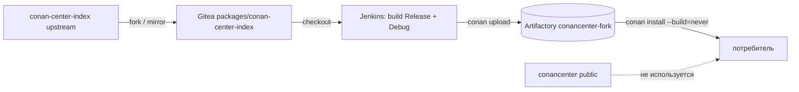

# 09 — форк Conan Center как источник рецептов и бинарников

Цель: заменить публичный `conancenter` приватным форком
`conan-center-index`, собирать третьесторонние пакеты из форка и публиковать
готовые бинарники в отдельный remote Artifactory `conancenter-fork`.

Команды выполняются из корня репозитория, если не указано иное.

```bash
export LAB_ROOT="$PWD"   # корень conan2-ci-lab
```

Сценарий отвечает на три вопроса:

- как внести правку в рецепт, не дожидаясь upstream;
- как зафиксировать снимок Conan Center, чтобы он не менялся под ногами;
- как сделать так, чтобы потребители не смешали бинарники форка с бинарниками
  публичного центра.

## Зачем нужен форк

| Причина | Что даёт форк |
|---|---|
| Патч рецепта под свою платформу/тулчейн | изменение доступно сразу, без PR в upstream |
| Воспроизводимость | фиксируется commit форка, а не «текущий master» |
| Своя политика сборки | опции по умолчанию, флаги, shared/static, toolchain |
| Запрет скачивать чужие бинарники | все бинарники собираются в своём CI |
| Лицензионные ограничения | рецепт не обязан попадать в публичный центр |

Форк — это **исходники рецептов**. Бинарники в Gitea не хранятся: их собирает
Jenkins и загружает в Artifactory, как и остальные пакеты стенда.

## Топология



Публичный `conancenter` намеренно **не** входит в граф потребителя: иначе один
и тот же `name/version` может разрешиться то в форк, то в upstream.

## Предусловия

- Стенд запущен, `conan >= 2.32` в `PATH` (проверено на 2.33.0).
- Есть организации `packages` и `products` в Gitea (их создаёт bootstrap).
- В Artifactory есть LOCAL Conan-репозиторий `conancenter-fork`.
  Он объявлен в `artifactory-init` (`docker-compose.yml`). Если стенд был
  поднят до этого изменения, примените конфигурацию повторно:

```bash
docker compose run --rm artifactory-init
```

- `conancenter-fork` — обычный LOCAL-репозиторий. Отдельный virtual-репозиторий
  не нужен: смешивать форк с upstream не следует (см. «Ограничения»).

## 1. Форк и фиксация снимка

Клонируйте upstream и отправьте его в Gitea. Shallow-клон допустим для
просмотра, но Gitea отклоняет push из shallow-репозитория
(`shallow update not allowed`), поэтому перед push снимите ограничение.

```bash
rm -rf /tmp/cci-fork
git clone --depth 1 https://github.com/conan-io/conan-center-index.git /tmp/cci-fork
export GITEA_TOKEN="$(cat "$LAB_ROOT/.secrets/gitea-token")"

# Репозиторий packages/conan-center-index: 201 — создан, 409 — уже существует.
curl -sS -o /dev/null -w '%{http_code}\n' \
  -H "Authorization: token ${GITEA_TOKEN}" \
  -H 'Content-Type: application/json' \
  -d '{"name":"conan-center-index","private":true,"default_branch":"master"}' \
  http://localhost:3000/api/v1/orgs/packages/repos

cd /tmp/cci-fork
git fetch --unshallow
# Gitea принимает токен в заголовке; basic-auth admin:token здесь даёт 401.
git -c http.extraHeader="Authorization: token ${GITEA_TOKEN}" push --force \
  http://localhost:3000/packages/conan-center-index.git HEAD:master
```

`--force` делает повторный прогон идемпотентным: репозиторий Gitea может уже
содержать предыдущий снимок форка.

Зафиксируйте базовый commit upstream (до правок):

```bash
git rev-parse HEAD | tee /tmp/cci-fork-base.txt
```

Этот commit — исходная точка форка. Ветка `master` в форке может двигаться;
конкретный commit — нет.

## 2. Правка рецепта

Пример: приватная политика «zlib собирается shared по умолчанию». В
`recipes/zlib/all/conanfile.py`:

```diff
     default_options = {
-        "shared": False,
+        "shared": True,
         "fPIC": True,
     }
```

Это изменение меняет recipe revision и package ID относительно публичного
центра. Любая другая правка (патч, новая опция, другой источник) работает так
же: рецепт читается из папки форка напрямую.

```bash
git add recipes/zlib/all/conanfile.py
git commit -m "fork: build zlib shared by default"
git -c http.extraHeader="Authorization: token ${GITEA_TOKEN}" push --force \
  http://localhost:3000/packages/conan-center-index.git HEAD:master

# Именно этот commit попадает в сборку и в артефакты релиза.
git rev-parse HEAD | tee /tmp/cci-fork-commit.txt
```

## 3. Подключить форк как local-recipes-index

Conan 2 умеет использовать папку с раскладкой `conan-center-index` как
remote типа `local-recipes-index`. Такой remote отдаёт **только рецепты**;
бинарники придётся собрать.

```bash
cd "$LAB_ROOT/demo/conan-migration-sandbox"

export CONAN_HOME=/tmp/conan-cci-fork
rm -rf "$CONAN_HOME"
conan profile detect --force

# Публичный центр не должен участвовать в резолве.
conan remote remove conancenter || true

# allowed-packages ограничивает remote только нужными рецептами.
conan remote add cci-fork /tmp/cci-fork \
  -t local-recipes-index --allowed-packages="zlib/*"

conan list "zlib/*" -r=cci-fork
```

Ожидается `zlib/1.3.2` (набор версий берётся из `recipes/zlib/config.yml`).

## 4. Собрать бинарник из форка

```bash
conan install --requires=zlib/1.3.2 \
  -r=cci-fork \
  -pr:h=profiles/linux-gcc-release \
  -pr:b=profiles/linux-gcc-release \
  -s build_type=Release \
  --build=missing
```

Что происходит:

1. рецепт читается из `/tmp/cci-fork` (recipe revision форка);
2. исходники скачиваются по `conandata.yml`;
3. пакет собирается локально, потому что в `local-recipes-index` бинарников нет;
4. в кэше появляется pref с package revision.

Для пакета с зависимостями `--build=missing` соберёт весь граф. В этом
`CONAN_HOME` настроен только `cci-fork`, поэтому и зависимости резолвятся
только из форка; форк должен содержать их рецепты. Если добавить второй remote,
Conan будет искать зависимости и в нём — тогда часть графа может прийти из
upstream. Для воспроизводимости держите один remote.

Повторите сборку для Debug, если пакет должен публиковаться в обеих
конфигурациях:

```bash
conan install --requires=zlib/1.3.2 \
  -r=cci-fork \
  -pr:h=profiles/linux-gcc-debug \
  -pr:b=profiles/linux-gcc-debug \
  -s build_type=Debug \
  --build=missing
```

Правило «сначала обе конфигурации, потом upload» — из сценария 05.

## 5. Опубликовать в Artifactory

```bash
export ARTIFACTORY_URL=http://localhost:8082
export ARTIFACTORY_USER=admin
export ARTIFACTORY_PASSWORD="$(grep '^ARTIFACTORY_PASSWORD=' "$LAB_ROOT/.env" | cut -d= -f2-)"

conan remote add conancenter-fork \
  "$ARTIFACTORY_URL/artifactory/api/conan/conancenter-fork" \
  --allowed-packages="zlib/*"
conan remote login conancenter-fork "$ARTIFACTORY_USER" \
  -p "$ARTIFACTORY_PASSWORD"

conan upload "zlib/1.3.2:*" -r=conancenter-fork -c
```

`conan upload` отправляет рецепт и все собранные package ID. Проверка:

```bash
conan list "zlib/1.3.2:*#*" -r=conancenter-fork
```

В выводе должны быть `package_id` и `package_rev` для каждой собранной
конфигурации. Для пакета с зависимостями повторите upload для всех refs графа
(в CI удобно брать их из lockfile/build-order, а не перечислять вручную).

## 6. Проверить чистым потребителем

Отдельный `CONAN_HOME` и единственный remote `conancenter-fork`:

```bash
export CONAN_HOME=/tmp/conan-cci-consumer
rm -rf "$CONAN_HOME"
conan profile detect --force

# default conancenter не должен оставаться в резолве.
conan remote remove conancenter || true

conan remote add conancenter-fork \
  "$ARTIFACTORY_URL/artifactory/api/conan/conancenter-fork"
conan remote login conancenter-fork "$ARTIFACTORY_USER" \
  -p "$ARTIFACTORY_PASSWORD"

conan install --requires=zlib/1.3.2 \
  -r=conancenter-fork \
  -pr:h=profiles/linux-gcc-release \
  -pr:b=profiles/linux-gcc-release \
  -s build_type=Release \
  --build=never
```

`--build=never` — обязательная часть проверки: если бинарника нет, команда
должна упасть, а не собрать пакет из исходников «похожим» рецептом.

Дополнительно убедитесь, что публичный центр не подключён:

```bash
conan remote list
# ожидается только conancenter-fork
```

## 7. Зафиксировать lockfile

```bash
mkdir -p lockfiles/cci-fork
conan lock create --requires=zlib/1.3.2 \
  -r=conancenter-fork \
  -pr:h=profiles/linux-gcc-release \
  -pr:b=profiles/linux-gcc-release \
  -s build_type=Release \
  --lockfile-out=lockfiles/cci-fork/zlib-1.3.2.lock

conan list "zlib/1.3.2:*#*" -r=conancenter-fork --format=json \
  --out-file=lockfiles/cci-fork/zlib-1.3.2-packagelist.json

git -C /tmp/cci-fork rev-parse HEAD \
  > lockfiles/cci-fork/CCI_COMMIT
```

Lockfile фиксирует ревизии рецептов, `CCI_COMMIT` — снимок форка. Package list
по-прежнему нужен отдельно: без него нельзя гарантировать, что скачается
именно собранный бинарник (см. сценарий 04).

## 8. Как это встраивается в CI

1. Jenkins job `conan-center-fork` делает checkout из
   `packages/conan-center-index` на зафиксированный commit.
2. Job собирает нужный набор пакетов с `--build=missing` для Release и Debug
   в чистом `CONAN_HOME`, где единственный remote — `cci-fork`.
3. После успешной сборки job загружает рецепты и бинарники в
   `conancenter-fork` и сверяет package ID (как `ci-package-release.sh`).
4. Job сохраняет commit форка, lockfile и package list как артефакты.
5. Потребители и продуктовые пайплайны получают только remote
   `conancenter-fork`. Публичный `conancenter` не добавляется.

`local-recipes-index` не даёт истории ревизий: он отражает только текущее
состояние папки. Поэтому в CI нужен либо checkout на конкретный commit, либо
отдельный каталог на каждый релиз. Artifactory, наоборот, хранит ревизии — он
и является источником бинарников для потребителей.

## Ограничения и типичные ошибки

1. **Не смешивайте бинарники.** Пакеты из публичного ConanCenter и из форка
   могут быть собраны разным тулчейном и с разными опциями. Официальная
   рекомендация — собирать из форка всё замыкание зависимостей, а не
   подтягивать часть из upstream.
2. **Одинаковые `name/version` — разные ревизии.** `zlib/1.3.2` из форка и из
   центра — разные recipe revision. Если в `CONAN_HOME` остались оба remote,
   Conan выберет ревизию по timestamp, и результат перестанет быть
   предсказуемым; кэш может закрепить уже скачанную ревизию. Для потребителя
   оставляйте один `conancenter-fork`; для точечного ограничения используйте
   `--allowed-packages`.
3. **`local-recipes-index` — экспериментальный тип.** Он не хранит бинарники
   и ревизии, не является заменой Artifactory. В production используйте его
   только как источник рецептов в CI.
4. **Форк не публикуется в публичный центр.** `center.conan.io` read-only;
   `conan upload` туда невозможен и не нужен.
5. **Artifactory CE не поддерживает `conan art:promote`.** Перенос между
   репозиториями — только `list → download → upload` (как `promote.sh`).
6. **Gitea хранит только исходники.** Не настраивайте Gitea как Conan
   Package Registry; бинарники форка живут в Artifactory.

## Ожидаемый результат

- `conan list "zlib/*" -r=cci-fork` показывает рецепты из форка.
- `conan install --requires=zlib/1.3.2 -r=cci-fork --build=missing` собирает
  пакет из рецепта форка.
- В `conancenter-fork` лежат рецепт и бинарники с `package_rev`.
- Чистый потребитель с единственным remote `conancenter-fork` ставит пакет с
  `--build=never`.
- Lockfile и commit форка сохранены; upstream `conancenter` в резолве не
  участвует.
